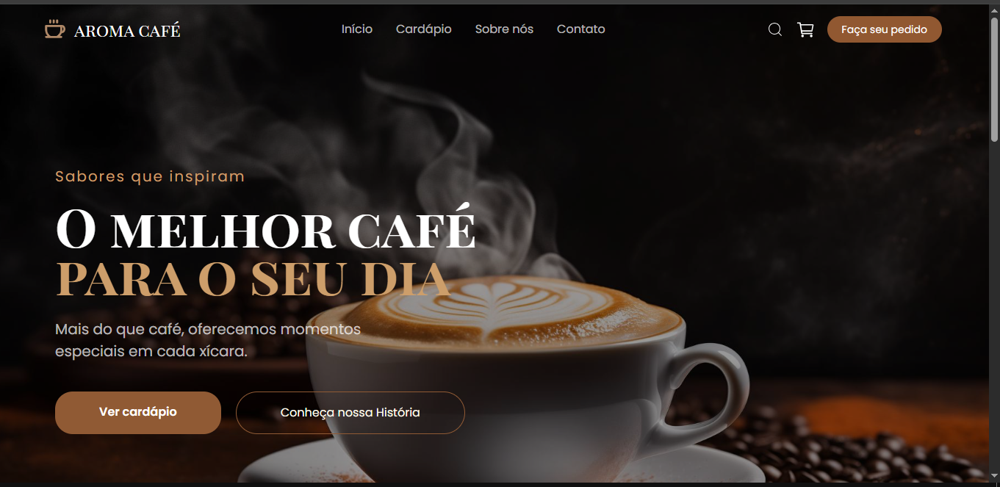
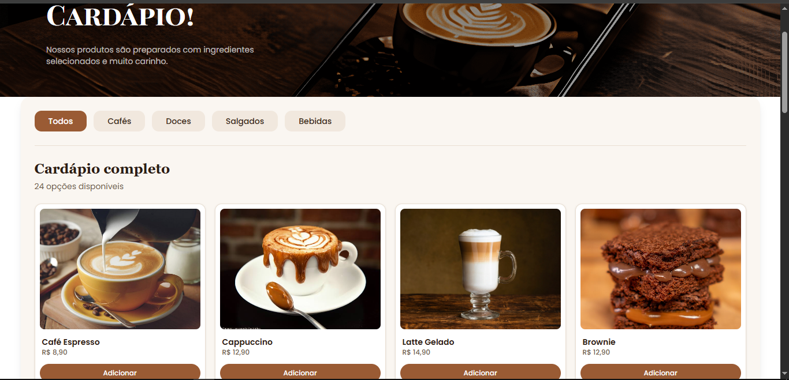
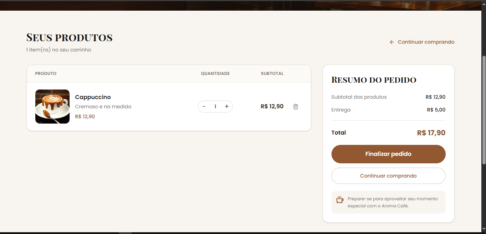

# ☕ Aroma Café

### E-commerce e experiência digital para uma cafeteria

O **Aroma Café** é um projeto de desenvolvimento web criado para praticar e aprimorar conhecimentos em Front-end. A aplicação apresenta a identidade visual de uma cafeteria por meio de uma interface moderna, acolhedora e intuitiva.

O projeto faz parte do meu portfólio de estudos e demonstra a aplicação prática de React, JavaScript, organização de componentes, navegação entre páginas e estilização com Tailwind CSS.

## ✨ Funcionalidades

- Página inicial com apresentação da cafeteria.
- Página institucional sobre a marca.
- Cardápio com produtos e categorias.
- Seção de produtos em destaque.
- Carrinho de compras interativo.
- Adição e remoção de produtos do carrinho.
- Controle de quantidades e cálculo do valor total.
- Pesquisa de produtos.
- Página de login.
- Páginas de contato e localização.

## 🛠️ Tecnologias utilizadas

- **React** — construção de interfaces por componentes.
- **JavaScript** — lógica e interatividade.
- **Vite** — ambiente de desenvolvimento e ferramenta de build.
- **Tailwind CSS** — estilização da interface.
- **React Router** — navegação entre páginas.

## 📸 Capturas de tela

### Página inicial



### Cardápio



### Carrinho de compras



## 🚀 Como executar o projeto

### Pré-requisitos

- [Node.js](https://nodejs.org/)
- npm
- Git

### Instalação

1. Clone o repositório:

   ```bash
   git clone https://github.com/MatheusMartins012/Aroma-Cafe-.git
   ```

2. Acesse a pasta do projeto:

   ```bash
   cd Aroma-Caf-
   ```

3. Instale as dependências:

   ```bash
   npm install
   ```

4. Inicie o servidor de desenvolvimento:

   ```bash
   npm run dev
   ```

5. Abra no navegador o endereço local informado pelo terminal.

## 📚 Aprendizados

Durante o desenvolvimento deste projeto, são praticados conceitos como:

- Criação e reutilização de componentes React.
- Organização de páginas e rotas.
- Estilização de interfaces com Tailwind CSS.
- Gerenciamento de estado e interação com o carrinho.
- Construção de interfaces responsivas.
- Organização de um projeto Front-end.

## 👨‍💻 Autor

**Matheus Martins**

Desenvolvedor Front-end em formação, com foco em React, JavaScript e desenvolvimento de interfaces web.

- GitHub: [MatheusMartins012](https://github.com/MatheusMartins012)

---

*Projeto desenvolvido para fins de estudo e portfólio profissional.*
